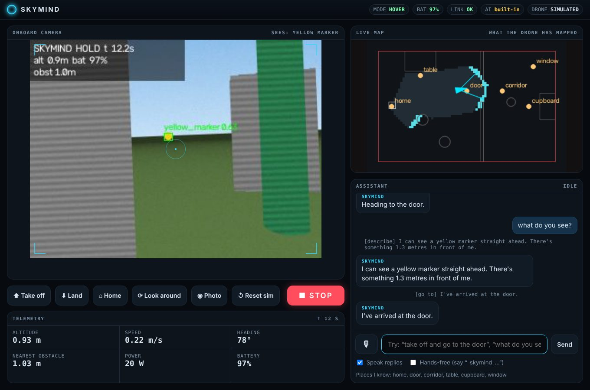

# SkyMind Assistant: talk to your drone

A voice and chat co-pilot in a web app. You speak or type in plain English; the
assistant understands, flies, looks, and answers:

> **You:** "SkyMind, go to the door and tell me if anyone's there."
> **SkyMind:** "On my way to the door, then I'll have a look." … "I'm at the door. I can see the doorway and nobody is there."



The app shows the live onboard camera with AI detection boxes, a live map of what
the drone has mapped (with your named places), telemetry, the conversation, quick
buttons, and a big **STOP** (also the **Esc** key).

## Quick start (simulated drone, nothing to buy)

```bash
pip install -r requirements.txt
python -m skymind app --config config/nano_room.yaml
# open http://localhost:8080 in Chrome
```

That already works with the **built-in command parser**: "take off", "go to the door",
"look around", "find the red marker", "what do you see", "go up a bit", "turn left 45",
"come back", "stop".

## Turn on the local AI (free, offline)

1. Install Ollama from https://ollama.com.
2. Download the two models once (about 3.6 GB together):

   ```bash
   ollama pull qwen2.5:3b     # understands requests and plans actions
   ollama pull moondream      # looks at camera images ("what do you see?")
   ```

3. Start the app again. The top bar shows **AI qwen2.5:3b + moondream**.

Laptop guide: 8 GB RAM works, 16 GB is comfortable. A plan takes roughly 1–5 s on a
laptop CPU, and an image description roughly 5–15 s, faster with a GPU. Other models
work too: `--model llama3.2:3b`, or `--vision-model gemma3:4b`. Use `--vision-model ""`
to skip vision.

## Talking to it

* **Push to talk:** click 🎙 (or press **Space**), speak, release.
* **Hands-free:** tick *Hands-free* and start sentences with the wake word:
  "SkyMind, take off". The word **"stop"** is obeyed at any time, even without
  the wake word.
* Replies are spoken aloud (untick *Speak replies* to mute).
* Voice input needs **Chrome or Edge** on **localhost** (browsers only allow the microphone
  on localhost or HTTPS). Chrome's speech recognition uses Google's online service, so voice
  *input* needs internet. The AI, spoken replies, video and flying all stay on your laptop.
  Typing always works.

Things you can say:

| You say | What happens |
|---|---|
| "take off" / "land" / "come back" | Instant, never waits for the AI |
| "go to the table", "fly to the corridor" | Flies there around obstacles (named places are in the scenario config) |
| "move forward 2 metres", "turn right 45", "go up a bit" | Relative moves |
| "look around" | 360° scan, then reports everything it recognised and where |
| "find the red bag" / "approach the chair" | Searches, turns to face it, says how far away it is, can fly up close |
| "what do you see?" | Describes the camera view (vision model, or detector summary) |
| "how's the battery?" | Status report, answered *without* interrupting a flight |
| "take a photo" | Saves a snapshot |
| Anything more complex | "Check the door, then the window, and come back" is planned into steps by the AI |

## How it decides (and why it's safe)

```
you ──► rules: stop / takeoff / land / home?  ──yes──► do it now
          │ no
          ▼
      local LLM ──► {"reply": "...", "actions": [go_to(door), describe()]}
          │          (structured JSON; only the listed skills; max 6 steps)
          ▼
      skills ──► live session ──► flight brain: avoidance, geofence, battery, link failsafes
          │
          ▼
      results ──► LLM writes a short answer from what *actually happened*
```

* **The AI only gives orders. It never flies the motors.** Every skill goes through the
  same flight brain as autonomous missions, so a confused model can't fly into a wall or
  out of the geofence.
* **STOP never waits for the AI.** The button, the Esc key and the spoken word cancel the
  current task and hold position on the next control tick.
* **Questions don't interrupt flights.** Status and describe requests run alongside the
  current task; a new *movement* command replaces the old one.
* **Grounded answers.** The final reply is written only from the skill results, so it doesn't
  claim things that didn't happen.
* **Refusals.** The assistant is instructed to refuse weapons, dropping things on people,
  chasing, spying on or secretly recording people, and flying outside the allowed area.
* **Fallback.** If Ollama isn't running or a model is missing, the built-in parser keeps the
  everyday commands working and the app says so.

## Real drone

```bash
# Nano build: join the drone's WiFi first. Bench mode: everything works except takeoff.
python -m skymind app --config config/nano_room.yaml --esp-drone udp://192.168.43.42
# allow real flight
python -m skymind app --config config/nano_room.yaml --esp-drone udp://192.168.43.42 --arm
```

Real-drone support uses the same session and skills as the simulator, but it has not
been flight-tested yet. Bench-test with the props off first (see `docs/BUDGET_BUILD.md`).

## Using a phone

`--host 0.0.0.0` makes the app reachable from your phone on the same WiFi. The printed
link contains an **access token**; without it every request is refused, so nobody else on
the network can fly your drone. Video, map, chat and STOP work on the phone. Voice input
doesn't, because browsers block the microphone on plain-HTTP LAN addresses, so speak on the laptop.

## Named places

Each scenario lists places in its config:

```yaml
mission:
  places:
    door: [4.0, 0.7]
    table: [1.9, 1.4]
```

For your real room, measure positions from the take-off point (x forward, y left, metres).

Every app session is recorded like any flight, so `python -m skymind judge runs/app-…`
scores it afterwards.
