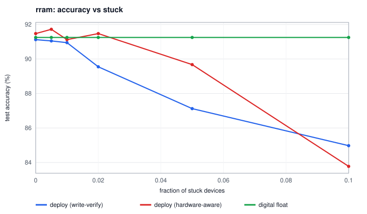
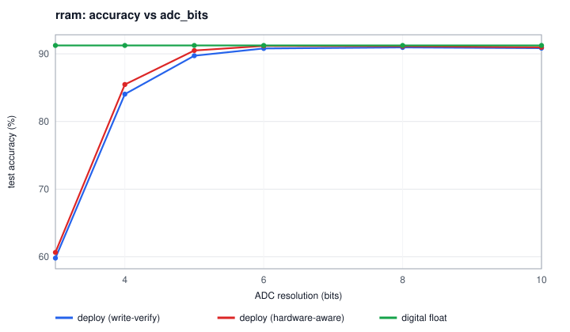
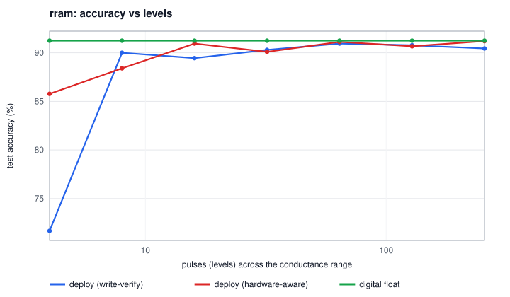
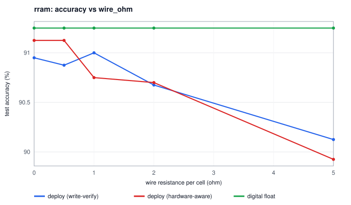
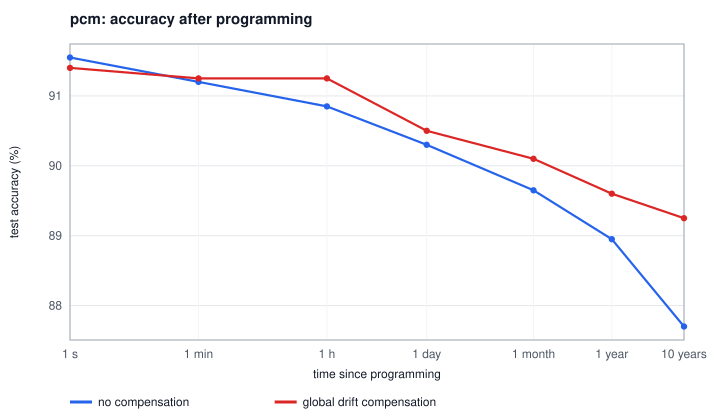

# MemBrain: an AI that computes and learns inside memristors

MemBrain is a simulator for neural networks whose weights are stored in **memristor crossbar
arrays**, and whose matrix multiplications are done by physics (Ohm's law and Kirchhoff's current
law) instead of a digital processor. You can train a network digitally and program it into the
memristors, or let it **learn directly on the chip** with programming pulses. You can then see what
real device physics does to it.

It is pure Python + NumPy, needs no downloads (the digit dataset is generated procedurally), and every
number below comes from the commands shown.

```
digits (16x16)  ->  DAC  ->  [ crossbar: G+ - G- ]  ->  ADC  ->  ReLU  ->  DAC  ->  [ crossbar ]  ->  ADC  ->  class
                             256 x 64 weights,                                   64 x 10 weights
                             split into 128-row tiles
```

## Why memristors

In a normal chip, most of the energy of a neural network goes into moving weights between memory
and the arithmetic units. A memristor *is* the memory and does the multiply in place: apply input
voltages to the rows, and the column currents are the dot products, for the whole matrix in one step.
The catch is that memristors are analog and messy. They have few levels, nonlinear and asymmetric
responses, noise, stuck cells and drift. MemBrain models those effects and the circuit tricks that
cope with them.

## Quick start

```bash
cd memristor-ai
pip install -r requirements.txt
python -m membrain devices                          # device presets + their pulse-response curves
python -m membrain demo                             # one network, eight ways, on RRAM (~40 s)
python -m membrain demo --device all                # every device technology (~5 min)
python -m membrain drift --device pcm               # accuracy over 10 years of conductance drift
python -m membrain sweep --knob stuck --values 0,0.01,0.02,0.05,0.1
python -m membrain sweep --knob levels --values 4,8,16,32,64 --insitu   # also train on-chip at each point
python -m pytest -q                                 # 29 tests, ~7 s
```

Knobs for `sweep`: `levels`, `nonlinearity`, `c2c`, `d2d`, `read_noise`, `stuck`, `adc_bits`,
`dac_bits`, `wire_ohm`, `tile_rows`. Every command writes a report, JSON and SVG charts to `runs/`.

## Results

A 256-64-10 network on procedurally generated, distorted digits (6000 train, 2000 test, 15 epochs).
The digital float32 reference reaches **91.2 %**.

### Eight ways onto four device technologies

`python -m membrain demo --device all`

| Method | ideal | RRAM | PCM | ECRAM |
|---|---:|---:|---:|---:|
| digital float32 (reference) | 91.2 % | 91.2 % | 91.2 % | 91.2 % |
| digital, hardware-aware training | 91.4 % | 91.4 % | 91.4 % | 91.4 % |
| deploy: open-loop programming | 91.2 % | 86.2 % | 87.0 % | 91.2 % |
| deploy: write-verify | 91.3 % | 87.9 % | 90.8 % | 91.2 % |
| deploy: write-verify + fault compensation | 91.3 % | 90.9 % | 90.8 % | 91.2 % |
| deploy: hardware-aware + verify + compensation | 91.4 % | **91.5 %** | **91.6 %** | 91.5 % |
| on-chip training, dual (SET-only + refresh) | 92.1 % | 87.8 % | **89.6 %** | **92.1 %** |
| on-chip training, reference column | 92.0 % | **89.1 %** | 85.5 % | 91.7 % |

What it shows:

* **Programming method matters most on RRAM.** Strong nonlinearity plus stuck cells cost 5 points
  with naive open-loop pulses. Write-verify recovers 1.7 points, re-targeting the partner device of
  stuck cells recovers 3 more, and hardware-aware training closes the gap entirely.
* **On-chip training depends on the device.** ECRAM's near-linear, symmetric steps let the network
  learn in the array as well as a digital one (92.1 %, within noise of the 91.2 % reference).
  RRAM and PCM lose 1.6–5.7 points, depending on the mapping.
* **The right weight mapping depends on the device.** PCM's RESET is abrupt, so the
  bidirectional "reference column" scheme suffers (85.5 %). SET-only training with periodic refresh
  works around it (89.6 %). RRAM is the other way round, likely because each refresh re-writes its
  coarse 64-level weights and adds error.

### Energy

Per inference, measured from the simulated currents, plus textbook peripheral costs. RRAM, 8-bit
ADC/DAC, 128-row tiles:

| | Energy per inference |
|---|---:|
| memristor crossbars | ≈ 0.27 nJ (mostly ADCs) |
| digital 8-bit MACs + SRAM weight fetches (45 nm) | ≈ 26 nJ |

That is about **100x less**. It's an order-of-magnitude estimate, not a chip measurement (see
[docs/HOW_IT_WORKS.md](docs/HOW_IT_WORKS.md#5-energy-membrainenergypy)). Deploying the RRAM network
takes about 0.3 million programming pulses (≈ 0.3 µJ); training it on-chip takes about 2 million.

### Robustness sweeps (RRAM, deployed)

| Stuck devices | ADC resolution |
|---|---|
|  |  |
| Hardware-aware training absorbs up to ~2 % stuck cells at no cost. | Accuracy drops steeply below 5 bits (84 % at 4, 60 % at 3); 6 bits is enough here. |

| Levels per device | Wire resistance (IR drop) |
|---|---|
|  |  |
| With write-verify, 16 levels are within 2 points; at 4 levels hardware-aware training matters (85.8 % vs 71.7 %). | Differential pairs and calibrated ADCs tolerate a few ohms per cell. |

### Drift (PCM)

`python -m membrain drift --device pcm`: program once, then read the same chip later.



Conductance falls to 0.38x of its programmed value after ten years. Accuracy goes from 91.5 % to
87.7 % raw, or 89.2 % with global drift compensation (one digital gain per layer, re-measured on a
calibration batch).

## How it works

The full write-up is in [docs/HOW_IT_WORKS.md](docs/HOW_IT_WORKS.md). In short:

* **Device** (`membrain/device.py`): a saturating-exponential pulse response with separate SET/RESET
  nonlinearity, finite levels, cycle-to-cycle and device-to-device variation, read noise, stuck-ON/OFF
  cells and power-law drift. Presets: `ideal`, `rram`, `pcm`, `ecram`.
* **Programming**: a closed-loop write-verify controller that only knows the *nominal* device curve.
  It RESETs and retries for abrupt-RESET devices, and compensates stuck cells through the partner
  device of each differential pair.
* **Crossbar** (`membrain/crossbar.py`): differential pairs (`dual` or `ref` mapping), DAC/ADC
  quantisation, 128-row tiling with per-tile ADCs, exact read noise, and an IR-drop solver for the
  resistive wire mesh, checked against exact nodal analysis in the tests.
* **Network** (`membrain/network.py`): forward = crossbar read, backward = *transposed* crossbar
  read, update = programming pulses with stochastic rounding.

```
membrain/
  device.py       memristor physics, write-verify programming
  crossbar.py     analog matrix-vector multiply, periphery, IR drop, on-chip updates
  network.py      digital / analog layers, MLP, training, deploy (to_analog)
  energy.py       inference energy: crossbar vs digital
  data.py         procedural hand-drawn digits
  experiments.py  demo, sweeps, drift, device curves
  svg.py          dependency-free charts
  cli.py          python -m membrain ...
tests/            device physics, circuit, network and end-to-end tests
docs/             HOW_IT_WORKS.md and the charts above
```

## Limits

The device presets are representative of each technology's behaviour, not fitted to a specific
chip. The model assumes 1T1R cells (no sneak paths) and leaves out endurance, temperature and latency.
The energy numbers are estimates. Results come from one seed on a 2000-image test set (±0.6 %
sampling error), so treat differences under a point as noise.

License: MIT
