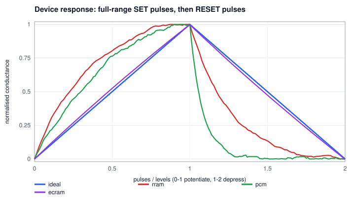

# How MemBrain works

MemBrain simulates a neural network whose weights are stored as the conductances of memristors in
crossbar arrays, and whose matrix multiplications happen *inside* those arrays as analog currents.
This page walks from one device up to the trained network, and lists what is and isn't modelled.

## 1. One memristor (`membrain/device.py`)

A memristor's conductance G sits between `g_min` and `g_max`. A SET pulse raises it, a RESET pulse
lowers it, and it stays put when you only read it with a small voltage. That makes it a non-volatile
analog weight.

Real devices are not linear. MemBrain uses the saturating-exponential model widely fitted to measured
synaptic devices. On a normalised state `g = (G - g_min) / (g_max - g_min)`, `n` SET pulses give

```
g' = (1 - exp(-nu n / L)) / (1 - exp(-nu)) + g exp(-nu n / L)
```

where `L` is the number of pulses that spans the full range and `nu` is the nonlinearity (`nu -> 0`
is linear). RESET pulses use the same formula on `1 - g` with their own `nu`. Different SET and RESET
curves are the asymmetry that makes on-chip training hard.



On top of this, every device has:

| Effect | Parameter | Model |
|---|---|---|
| finite precision | `levels` | `L` pulses span the range |
| cycle-to-cycle noise | `c2c` | each pulse lands with noise std `c2c / L` per sqrt(pulse) |
| device-to-device variation | `d2d` | each device gets its own `g_min`, `g_max`, `nu` |
| read noise | `read_noise` | every read multiplies G by `1 + N(0, sigma)` |
| stuck devices | `stuck_off`, `stuck_on` | ignore all pulses, stay at `g_min` / `g_max` |
| drift (PCM) | `drift_nu`, `drift_nu_std` | `G(t) = G0 ((t + t0) / t0) ** -nu`, `nu` varies per device |

The four presets (`python -m membrain devices`) are representative values for each technology's
qualitative behaviour, not calibrated models of a specific chip.

### Programming: write-verify

`DeviceArray.program` is a closed loop: read, compare, pulse, repeat. The controller knows only the
technology's *nominal* curve (it inverts it to pick a pulse count), not each device's own variation,
noise or faults. That matches what a real programming circuit knows. Two details matter:

* **Tolerance per device**: half of one nominal SET step at the target plus the pulse noise. Asking
  for more precision than one pulse can deliver just makes the loop oscillate.
* **Abrupt RESET (PCM)**: such devices cannot be partially depressed. When one overshoots, the
  controller RESETs it and climbs back from `g_min`.

*Open-loop* programming (send the pulse count a linear device would need, never check) is kept as
the baseline.

## 2. The crossbar (`membrain/crossbar.py`)

Inputs are voltages on the rows, each device passes `I = G V` (Ohm's law), and currents add on each
column (Kirchhoff's current law). One read computes `y = x @ W` for the whole matrix at once, which
is where the energy saving comes from: the weights never move.

* **Signed weights**: a differential pair per weight, `W ∝ G+ - G-`.
  * `dual`: positive weights on G+, negative on G-. During training only SET pulses are used; when a
    device nears full scale both devices are RESET and the weight is re-written (a *refresh*).
  * `ref`: G- is a fixed mid-range reference; G+ goes up and down. Simpler, but it exposes the
    SET/RESET asymmetry.
* **Fault compensation**: after write-verify, a pair whose weight is still wrong (usually a stuck
  device) has its *partner* re-targeted so that `G+ - G-` is right. For a stuck-ON G+, G- is raised
  to match. This alone takes RRAM from 87.9 % to 90.9 %.
* **DAC**: inputs are scaled per sample by their abs-max (a digital gain) and quantised; negative
  inputs need a second read phase.
* **Tiling**: a physical array has at most `tile_rows` rows (128 by default). Longer dot products are
  split, and each tile's partial sum goes through its own ADC before digital addition.
* **ADC**: column currents are quantised to `adc_bits` over a range calibrated once on sample data.
* **Read noise**: summing independent per-device read noise over a column is exactly a Gaussian
  output noise of std `sigma * sqrt(sum (G V)^2)`, so it is applied that way.
* **IR drop**: wire resistance along rows and columns means far cells see less voltage. The node
  voltages of the whole resistive mesh are solved by fixed-point iteration. A test checks this
  against an exact nodal-analysis solve of the circuit.

## 3. The network (`membrain/network.py`)

A 256-64-10 perceptron (ReLU, softmax). Biases are an extra crossbar row driven by a constant 1.
The same training loop drives digital and analog layers:

| Step | Digital layer | Analog layer |
|---|---|---|
| forward | `x @ W` | one crossbar read |
| backward | `delta @ W.T` | one **transposed** crossbar read (inputs on columns) |
| update | `W -= lr * grad` | `-lr * grad` turned into whole programming pulses (stochastic rounding) |

The update is computed by the periphery as an outer product and then sent as pulses. What actually
changes in the array is decided by the devices: nonlinearity, asymmetry, noise and stuck cells.

### Ways to get a trained network onto a chip

1. **Deploy (ex-situ)**: train digitally, then program the weights with open-loop pulses, write-verify,
   or write-verify plus fault compensation.
2. **Hardware-aware training**: train digitally but clip weights to the crossbar range and inject
   weight noise (10 % of range) in every forward pass, so the network learns to tolerate device
   error. Then deploy as above.
3. **On-chip (in-situ) training**: the network learns directly in the crossbars from random initial
   weights. Every update is real programming pulses.

## 4. Drift compensation

PCM conductance decays roughly as a power law after programming. Because drift mostly shrinks all
conductances together, `MLP.drift_compensate` measures the mean output of each layer on a fixed
calibration batch right after programming. Later it re-measures and applies one digital gain per
layer. There's no retraining and no reprogramming. The raw network partly survives drift on its own
(argmax over ReLU layers ignores a common scale factor), so most of the loss comes from per-device
variation of the drift exponent. In the PCM run, accuracy falls from 91.5 % to 87.7 % after ten
years without compensation and to 89.2 % with it, so compensation recovers about 40 % of the loss.

## 5. Energy (`membrain/energy.py`)

Array energy is measured from the simulation: the sum of `V² G t_read` over every cell for the actual
test inputs. DAC, ADC and digital accumulation use per-conversion figures. The digital baseline is an
8-bit MAC plus fetching the weight from on-chip SRAM, using 45 nm numbers from Horowitz (ISSCC 2014).
ADCs dominate the analog budget, which is why ADC resolution matters (see the ADC sweep). These are
order-of-magnitude estimates, not chip measurements.

## What is not modelled

* Sneak paths in selector-less (passive) arrays: MemBrain assumes 1T1R cells.
* Endurance (wear-out after many writes), temperature dependence, random telegraph noise.
* Timing and latency, ADC sharing between columns, and the cost of the digital outer-product
  computation for on-chip training.
* Device presets are representative, not fitted to a particular foundry's data.
